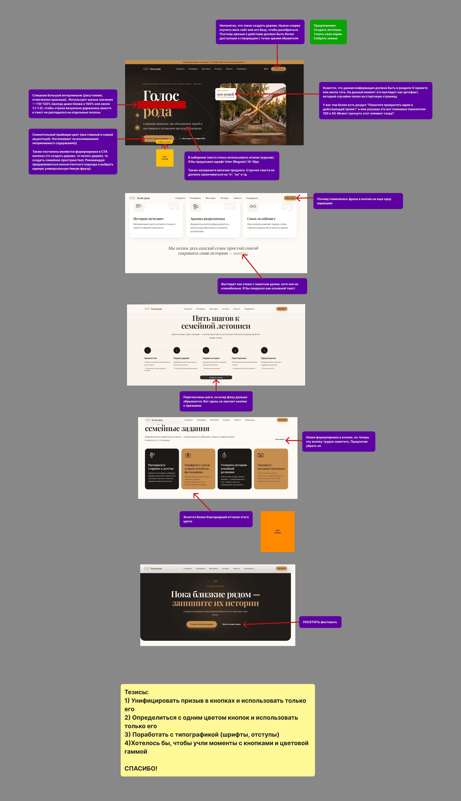

# Заметки по текущему сайту «Голос рода»

Дата разбора: 13 ноября 2026 года.

Источник: комментарии к макету главной страницы.

## Краткие выводы

1. Унифицировать призывы к действию в кнопках.
2. Выбрать один основной цвет кнопок и использовать его последовательно.
3. Доработать типографику: шрифты, межстрочные интервалы и переносы.
4. Завершить пользовательские пути понятными следующими действиями.
5. Пересмотреть расположение отдельных информационных блоков на главной странице.

## 1. Призывы к действию и названия кнопок

### Замечание

На странице используются разные формулировки для похожих действий:

- «Создать дерево»;
- «Начать семейное дерево»;
- «Собрать семью»;
- «Моя семья»;
- «Участвовать»;
- «Пройти на фестиваль».

Фраза «Создать дерево» может быть непонятна новому посетителю, который ещё не знает возможностей сервиса. Пользователю приходится сначала изучить сайт, чтобы понять результат нажатия.

### Предложения из комментариев

В качестве более понятных формулировок предложены:

- «Создать летопись»;
- «Узнать свои корни»;
- «Собрать семью».

Для перехода к фестивалю предложена формулировка «Посетить фестиваль» вместо «Пройти на фестиваль».

### Что требуется

- Определить одно основное действие главной страницы.
- Выбрать для него одну формулировку.
- Использовать эту формулировку во всех повторяющихся основных кнопках.
- Отдельные действия, например переход к фестивалю, называть в соответствии с их назначением.

## 2. Пользовательский путь на главной странице

### Блок «Пять шагов к семейной летописи»

Шаги перечислены, но после последнего шага дальнейшее действие пользователя не обозначено.

Предлагается добавить под блоком заметную кнопку с выбранным основным призывом.

### Блок «Семейные задания»

Кнопка «Участвовать» плохо заметна и использует ещё одну формулировку действия.

Предлагается решить одно из двух:

- убрать кнопку, если карточки заданий уже являются точками входа;
- заменить её на заметную кнопку с конкретным действием.

### Финальный блок страницы

Формулировку «Пройти на фестиваль» предлагается заменить на «Посетить фестиваль».

## 3. Типографика

### Межстрочный интервал в главном заголовке

В заголовке «Голос рода» используется слишком большой интерлиньяж. Строки визуально распадаются на отдельные полосы.

Предлагаемый ориентир для межстрочного интервала: 110–120% от размера шрифта, либо значение `1.1–1.2`.

### Основной текст

Для наборного текста не рекомендуется постоянно использовать курсив.

Предложение из комментария:

- использовать прямое начертание;
- рассмотреть шрифт Inter Regular;
- использовать размер 16–18 пикселей для основного текста.

### Переносы строк

Следует убрать висячие короткие предлоги и союзы. Строки не должны заканчиваться на «и», «на», «в» и подобные короткие слова.

### Выделение слова «вместе»

Слово «вместе» оформлено так, будто является ссылкой, хотя оно не нажимается.

Предлагается оформить его тем же цветом, что и основной текст, либо сделать настоящей ссылкой, если переход действительно нужен.

## 4. Цвета и кнопки

### Основной акцентный цвет

Красный цвет в роли главного акцента вызывает нежелательные ассоциации и не поддерживает заявленный образ семейного наследия.

Предлагается:

- выбрать один основной акцентный цвет бренда;
- использовать его для основных кнопок и активных элементов;
- не менять цвет одинаковых по назначению кнопок от блока к блоку.

### Золотой и оранжевый оттенки

Текущий яркий оранжевый цвет карточек и кнопок предлагается заменить на более спокойный и благородный оттенок, соответствующий общей тёмно-зелёной и золотой гамме проекта.

Конкретный цвет следует определить в дизайн-системе и зафиксировать его код.

## 5. Информационные блоки

### Карточка «100 семей»

Блок со счётчиком «100 семей» выглядит на главном экране как отдельный случайный элемент.

Похожие плановые показатели «100» и «50» уже используются в разделе о превращении идеи в действующий проект.

Предлагается выбрать один вариант:

- перенести показатели в раздел «О проекте»;
- оставить их только в блоке с планами проекта;
- убрать карточку с главного экрана, если она дублирует другую информацию.

## 6. Предлагаемый список изменений

### В первую очередь

1. Определить главное действие пользователя на стартовой странице.
2. Выбрать единую формулировку основной кнопки.
3. Выбрать единый основной цвет кнопок.
4. Уменьшить межстрочный интервал в главном заголовке.
5. Заменить курсив в наборном тексте на прямое начертание.
6. Добавить следующее действие после блока «Пять шагов к семейной летописи».
7. Определить место для показателей «100 семей» и «50».

### Следующим этапом

1. Исправить висячие предлоги и союзы.
2. Пересмотреть кнопку «Участвовать» в блоке семейных заданий.
3. Заменить «Пройти на фестиваль» на «Посетить фестиваль».
4. Убрать оформление слова «вместе» как ссылки либо добавить настоящий переход.
5. Подобрать более спокойный золотой или оранжевый оттенок.
6. Зафиксировать шрифты, размеры, интервалы и цвета в единой дизайн-системе.

## 7. Что требуется оценить дизайнеру и разработчику

1. Какое действие является главным: создание дерева, семейного пространства или семейной летописи.
2. Какую единую формулировку основной кнопки использовать на сайте.
3. Нужен ли отдельный блок «100 семей» на главной странице.
4. Куда ведёт пользовательский путь после пяти шагов.
5. Нужна ли отдельная кнопка «Участвовать» над семейными заданиями.
6. Какие шрифты и размеры уже используются и насколько трудоёмка их замена.
7. Какие фирменные цвета закрепить за основными и дополнительными действиями.

## Статус

Заметки считаны и структурированы. Предложения ещё не утверждены и требуют оценки дизайнером и разработчиком.
