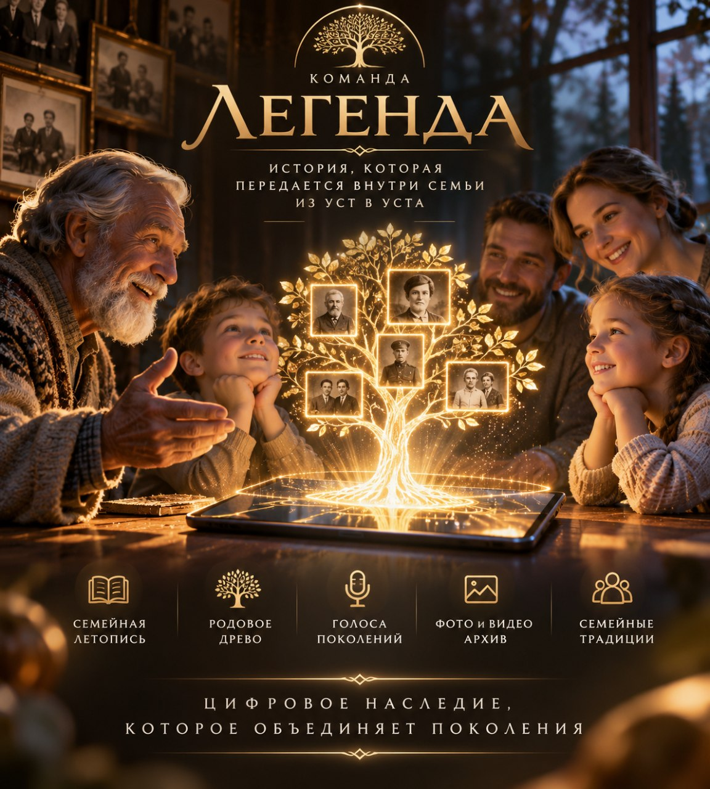
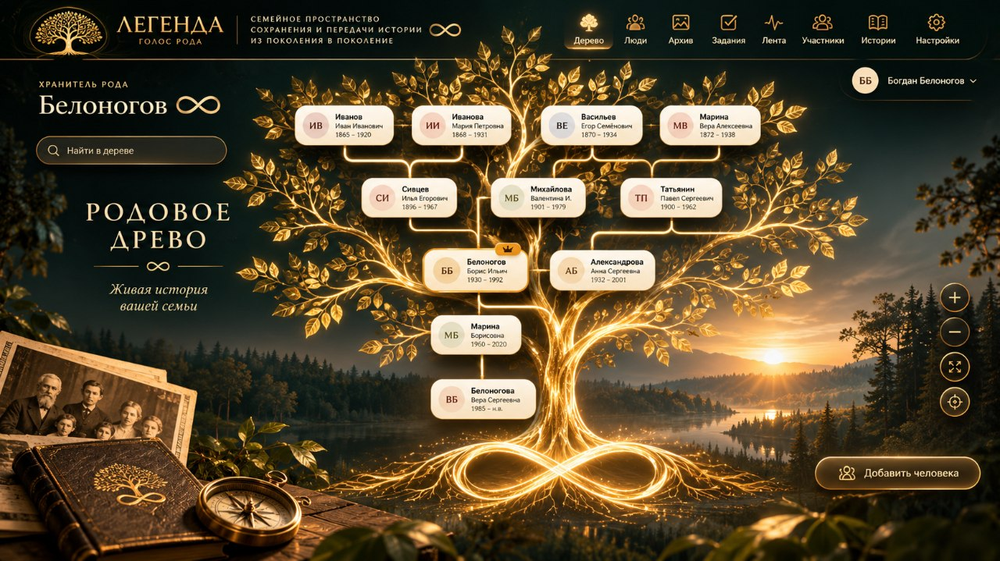

# Предложение по редизайну главного экрана

Статус: визуальное предложение подготовлено и передаётся разработчику для оценки реализуемости, сроков и стоимости. Это не согласованный и не утверждённый дизайн.

Предлагается сделать родовое дерево главным экраном семейного пространства. Архив, истории, люди и другие разделы дополняют дерево и открываются из верхней навигации.

## Визуальные референсы

На изображениях используется рабочее название «Легенда». Это только визуальные референсы. Название проекта в интерфейсе — «Голос рода».

### Общая концепция проекта

Из этого референса используются:

- образ семьи, объединённой общей историей;
- родовое дерево как центральный символ;
- сочетание тёмно-зелёного и тёплого золотого цветов;
- семейная летопись, голоса поколений, фото, видео и традиции как основные направления проекта.

### Главный экран с родовым деревом

Из этого референса используются:

- родовое дерево занимает основную часть экрана;
- карточки родственников расположены непосредственно на дереве;
- верхняя навигация содержит основные разделы семейного пространства;
- поиск по дереву находится слева;
- управление масштабом находится справа;
- кнопка добавления человека доступна на главном экране;
- данные архива и карточек людей связаны с деревом.

## Верхняя навигация

- Дерево.
- Люди.
- Архив.
- Истории.
- Участники.
- Настройки.

## Рабочая область

- Родовое дерево занимает основную часть экрана.
- Слева размещаются название семьи и поиск.
- Справа размещаются управление масштабом и кнопка добавления человека.
- Нажатие на карточку открывает сведения о родственнике.

## Действия на главном экране

- Найти человека по имени или фамилии.
- Увеличить, уменьшить и переместить дерево.
- Открыть карточку родственника.
- Добавить нового человека.
- Указать родственную связь.
- Перейти к документам, фотографиям и историям выбранного человека.

## Карточка человека

- Имя и фотография.
- Годы жизни.
- Родственная связь.
- Биография.
- События и места.
- Фото, документы, аудио и видео.
- Воспоминания и семейные истории.
